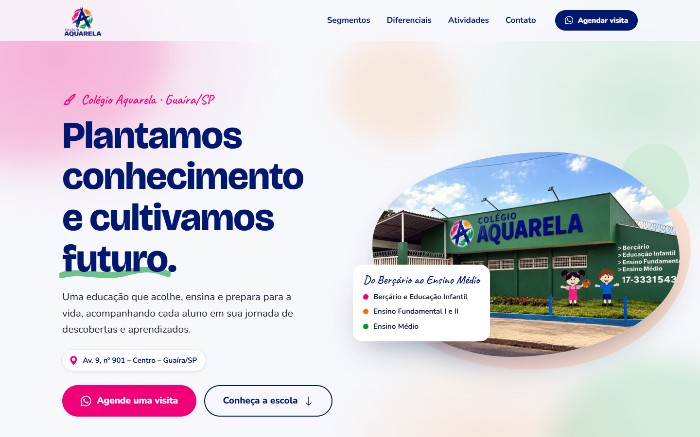
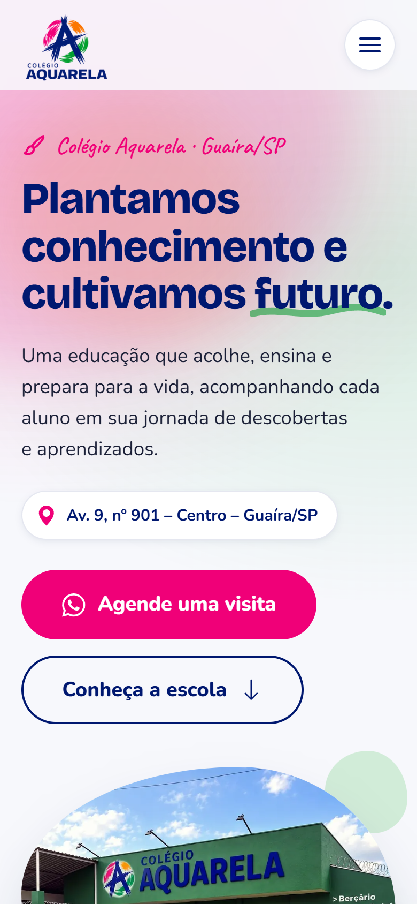
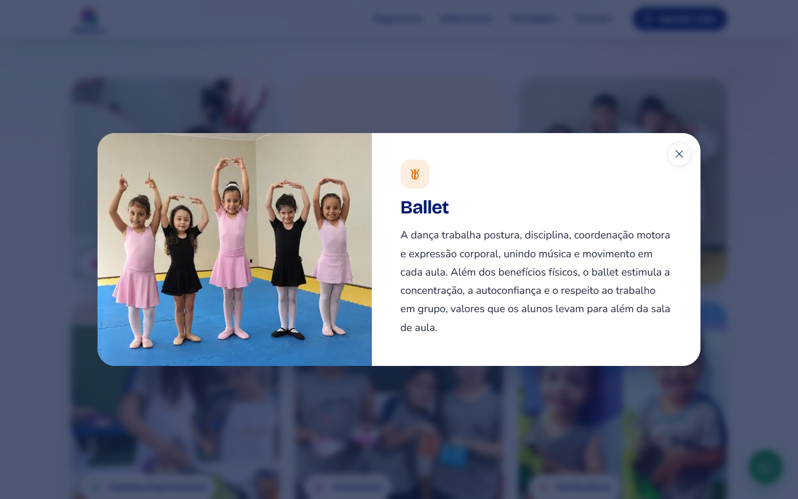
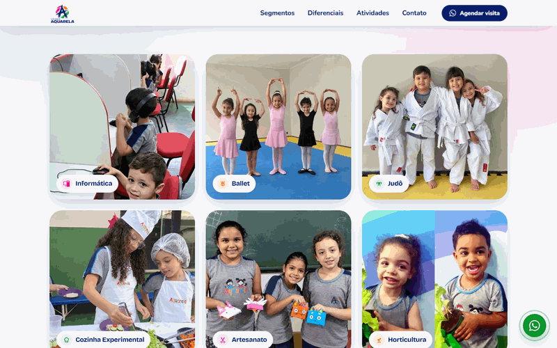

# Colégio Aquarela — site institucional

Site institucional de página única do Colégio Aquarela, escola de Guaíra/SP do Berçário ao Ensino Médio, feito com HTML, Sass e JavaScript puro sobre Vite.

**No ar:** [www.colegioaquarelaguaira.com.br](https://www.colegioaquarelaguaira.com.br)


## Capturas

Capturas do site publicado (31/10/2026).



| Celular | Card expandido (Atividades Extras) |
|---|---|
|  |  |

Animação do card expandido (GSAP Flip): a foto sai do card, vai até o painel e volta ao fechar.



## Sobre o projeto

**Cliente:** Colégio Aquarela, escola de Guaíra/SP que atende do Berçário ao Ensino Médio.

**Objetivo:** dar à escola uma presença própria na web, com domínio próprio, que apresente os segmentos, os diferenciais, as atividades extras e os espaços e leve o visitante a agendar uma visita pelo WhatsApp. Em época de processo seletivo, o mesmo site recebe uma seção de Vestibulinho.

**O que foi entregue:**

- página única responsiva (do celular ao desktop) com hero, segmentos, Sistema de Ensino Positivo, diferenciais, atividades extras, espaços, chamada final e rodapé com contato;
- identidade visual construída a partir da logo da escola: paleta extraída da logo vetorial ([`content/paleta-cores.md`](content/paleta-cores.md)), formas de "mancha de aquarela" e pinceladas;
- animações de entrada e de rolagem, e um card expandido para cada atividade extra;
- módulo sazonal do Vestibulinho (contador regressivo, datas, vagas e inscrição), ligado ou desligado por uma chave;
- pipeline de imagens, SEO técnico e publicação na Vercel com domínio próprio.

## Destaques técnicos

### Card expandido com GSAP Flip

Clicar numa atividade abre um diálogo em que a própria `<picture>` do card (o mesmo elemento, não uma cópia) é movida para o painel e "voa" da posição original até a coluna da imagem com `Flip.from`; título e descrição entram em sequência depois que a imagem pousa. Fechar faz o caminho inverso com `Flip.fit`. Antes de medir, o script espera a foto decodificar (com teto de 120 ms), para o voo não começar com a moldura vazia. — [`src/js/atividades.js`](src/js/atividades.js)

### Contador regressivo com troca de dígitos

Cada unidade (dias, horas, minutos, segundos) tem uma máscara com dois elementos empilhados: o número que sai sobe e some **ao mesmo tempo** que o novo entra por baixo, na mesma timeline, para nunca existir um quadro de troca seca. O relógio é alinhado à virada do segundo, e as datas exibidas e o alvo do contador saem da mesma constante (ISO com fuso de Brasília), então contam certo em qualquer fuso. — [`src/js/countdown.js`](src/js/countdown.js)

### Módulo sazonal com interruptor (Vestibulinho)

Uma chave em `site.config.js` (`vestibulinho.enabled`) liga e desliga o módulo inteiro. Os trechos ficam entre marcadores — `<!-- {{#VESTIBULINHO}} -->` no HTML e `// {{#VESTIBULINHO}}` no JS e no Sass — que um plugin do Vite remove no build e no `npm run dev`. Desligado, nada vai para o `dist/`: seção, itens de menu e rodapé, estilos e o próprio `countdown.js`, que nem entra no bundle. Marcador sem par ou com nome errado quebra o build de propósito, em vez de publicar a página pela metade.

### Configuração central em `site.config.js`, injetada por plugin do Vite

Dados da escola (nome, WhatsApp, telefone, endereço, redes, domínio), interruptores e IDs configuráveis vivem num arquivo só. Um plugin do Vite ([`vite.config.js`](vite.config.js)):

- substitui tokens `{{NOME}}` no `index.html`, com escape de HTML;
- expõe ao JS um global `__SITE__` via `define`;
- gera `sitemap.xml` e `site.webmanifest` e preenche a linha `Sitemap:` do `robots.txt` a partir do mesmo `siteUrl`;
- lê largura e altura da logo direto do cabeçalho do PNG, para o `` sair com dimensões explícitas (sem layout shift).

Trocar a logo do site inteiro (cabeçalho, rodapé, favicons, ícones PWA e imagem de Open Graph) é trocar uma linha: `logo: 'vetorial'` ou `'mascote'`. O snippet do Google Analytics (GA4) é outro exemplo: enquanto `tracking.ga4Id` for o placeholder `G-XXXXXXXXXX`, ele fica fora do build e nenhuma requisição sai.

### Pipeline de imagens com sharp

`npm run images` ([`scripts/optimize-images.mjs`](scripts/optimize-images.mjs)) gera a pasta `public/` a partir de `content/`:

- fotos em **WebP + JPG** em larguras responsivas por seção, usadas com `srcset`/`sizes` e `<picture>` (nunca amplia, só reduz e recomprime);
- logo do cabeçalho em WebP + PNG; favicons, ícones PWA e imagem de OG copiados como estão;
- a dupla de personagens da logo mascote isolada do SVG master: o script renderiza só os caminhos dos personagens e refaz o contorno branco por dilatação da silhueta;
- a logo de terceiro (Sistema de Ensino Positivo) só recortada (`trim`) e redimensionada, nunca recolorida.

### Acessibilidade

- **Foco preso** no diálogo do card e no menu mobile; `Esc` fecha; o foco volta ao elemento que abriu; o resto da página fica `inert` com o diálogo aberto (`role="dialog"` + `aria-modal`).
- **`prefers-reduced-motion`**: AOS desligado, nenhuma animação GSAP, o card abre com um fade curto e o contador só troca o texto.
- **Skip link** ("Pular para o conteúdo") e navegação completa por **teclado**: os cards são `<button>`, com anel de foco visível.
- Contador com resumo em texto (`role="timer"`) atualizado a cada minuto, enquanto os dígitos que mudam a cada segundo ficam fora do leitor de tela.
- Contraste AA documentado nas regras de cor (ex.: laranja nunca recebe texto branco) e imagens decorativas com `aria-hidden`/`alt=""`.

### SEO

`<link rel="canonical">`, Open Graph e Twitter Card (com imagem 1200×630), `sitemap.xml` gerado no build, `robots.txt` com a linha `Sitemap:`, `lang="pt-BR"`, meta description e manifest. Todas as URLs absolutas nascem de `site.config.js → siteUrl`: trocar o domínio é trocar uma linha.

## Qualidade

Lighthouse 13.6.0 no site publicado, em 31/10/2026: mediana de 3 execuções por modo, com throttling simulado (padrão do Lighthouse). As notas variam um pouco entre execuções e conexões.

| Modo | Performance | Acessibilidade | Boas práticas | SEO |
|---|:---:|:---:|:---:|:---:|
| Celular | 98 | 100 | 100 | 100 |
| Desktop | 99 | 100 | 100 | 100 |

## Stack

- **HTML5** semântico, página única
- **Sass** (módulos `@use`, tokens de design, mixins)
- **JavaScript** puro (ES modules)
- **GSAP 3** (ScrollTrigger, SplitText, Flip) para transições e **AOS** para revelar blocos na rolagem
- **Vite 8** com dois plugins próprios (tokens e blocos condicionais)
- **sharp** no pipeline de imagens
- Google Fonts (Bricolage Grotesque, Nunito, Caveat) e Bootstrap Icons em sprite SVG inline, com alguns ícones próprios
- Hospedagem na **Vercel**

## Estrutura de pastas

```
.
├── index.html              # markup da página (tokens {{...}} e blocos condicionais)
├── site.config.js          # dados da escola, interruptores e IDs configuráveis
├── vite.config.js          # plugins: tokens, blocos condicionais, robots/sitemap/manifest
├── robots.txt              # fonte do robots.txt (linha Sitemap via token)
├── content/                # fontes das imagens (originais)
│   ├── fotos/              # uma foto por seção/atividade
│   ├── logos/              # logo vetorial, logo mascote, logo Positivo e ícones
│   └── paleta-cores.md     # paleta e regras de uso
├── public/                 # gerada por `npm run images`; vai inteira para o dist/
│   ├── img/
│   └── logos/
├── scripts/
│   └── optimize-images.mjs # pipeline de imagens (sharp)
├── src/
│   ├── main.js
│   ├── js/                 # header, menu, animations, atividades (Flip), countdown
│   └── styles/             # abstracts, base, components, sections
└── docs/screenshots/       # imagens deste README
```

## Como rodar localmente

Requer Node.js 20.19+ ou 22.12+.

```bash
npm install
npm run dev       # servidor de desenvolvimento
npm run build     # gera dist/
npm run preview   # serve o dist/ localmente
npm run images    # regenera public/img e public/logos a partir de content/
```

`npm run images -- <nome>` regenera só uma foto (ex.: `npm run images -- hero`).

## Como reativar o Vestibulinho

O código da seção (HTML, Sass e `countdown.js`) continua no projeto; hoje a chave está desligada. Para o próximo processo seletivo:

1. **Foto da seção**: coloque o banner do processo (1600×900) em `content/vestibulinho/banner.jpeg` e rode `npm run images -- vestibulinho`. Isso gera `public/img/vestibulinho-{560,758}.{jpg,webp}`. A pasta `content/vestibulinho/` está no `.gitignore` (o banner não é versionado), mas as imagens geradas em `public/img/` precisam ser commitadas, porque a Vercel roda `npm run build`, não `npm run images`. O recorte em `processVestibulinho()` foi calibrado para o banner de 2027 e deve ser revisto para um banner novo; sem o arquivo, a etapa é pulada sem erro.
2. **Dados** em `site.config.js → vestibulinho`:
   - `enabled: true`;
   - `examDate`: data e hora da prova, com o fuso de Brasília (ex.: `'2026-10-06T17:00:00-03:00'`);
   - `enrollmentStart` e `enrollmentEnd`: início e fim das inscrições (só datas);
   - `scholarship`: texto da bolsa (ex.: `'até 50%'`);
   - `formUrl`: link do formulário de inscrição (hoje é o placeholder `https://forms.gle/EXEMPLO`);
   - `name` e, fora do bloco, `whatsappVestibulinhoMessage`, que levam o ano.
3. **No `index.html`**: as séries com vaga (lista `.vagas` da seção `#vestibulinho`) e o ano fixo no `<h2>` e no `countdown__year`.
4. `npm run build` e confira a seção, o contador e os botões de inscrição.

Um link novo para `#vestibulinho` em outra parte da página precisa ficar dentro de um bloco `{{#VESTIBULINHO}}`, senão vira link quebrado com a chave desligada.

## Créditos e direitos

- **Código**: Pedro Ross. O repositório é público para fins de portfólio e não acompanha licença de uso.
- **Marca, logotipos, textos e fotografias** pertencem ao Colégio Aquarela e são usados com autorização. Não estão licenciados para reuso.
- A **logo do Sistema de Ensino Positivo** é marca de terceiro e pertence ao seu titular.
- **Fontes, ícones e bibliotecas** seguem suas próprias licenças: Bricolage Grotesque, Nunito e Caveat (SIL Open Font License), Bootstrap Icons (MIT), GSAP (Standard "No Charge" License), AOS, Vite e Sass (MIT), sharp (Apache-2.0).

## Autor

**Pedro Ross** — [github.com/PedroRossZny](https://github.com/PedroRossZny)
