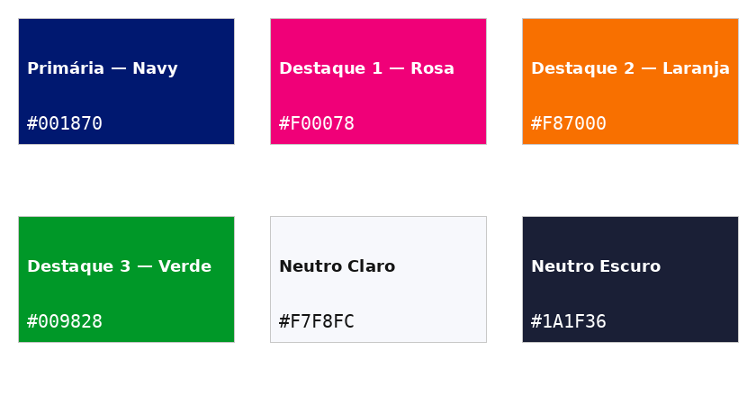

# Paleta de cores — Colégio Aquarela

## Origem

Extraída diretamente dos pixels do logotipo vetorial, não escolhida "no olho". O vetorial é um sistema de 4 cores já pensado como marca; a logo mascote tem mais de 15 tons (pele, cabelo, roupa, palavras do arco-íris) que funcionam numa ilustração, mas virariam inconsistência se o site inteiro tentasse seguir todos eles. A paleta vale para o site com qualquer uma das duas logos (`site.config.js → logo`).

Laranja e verde são praticamente idênticos entre as duas logos; azul e rosa são da mesma família, só com saturação diferente — por isso a paleta do vetorial também é compatível com a mascote.

## Cores

| Papel | Hex | Variável CSS | Uso |
|---|---|---|---|
| Primária — Navy | `#001870` | `--c-navy` | Títulos, logotipo, elementos de destaque forte |
| Destaque 1 — Rosa | `#F00078` | `--c-rosa` | Botões, hover, ícones de atividades |
| Destaque 2 — Laranja | `#F87000` | `--c-laranja` | Ícones, bordas e decoração |
| Destaque 3 — Verde | `#009828` | `--c-verde` | Botões, hover, ícones de atividades |
| Neutro Claro | `#F7F8FC` | `--c-claro` | Fundos de seção; fundo dos ícones (favicon, apple-touch, PWA, OG image) |
| Neutro Escuro | `#1A1F36` | `--c-escuro` | Texto de parágrafo longo — mais suave que o navy puro para leitura |

As variantes escuras (`--c-rosa-deep`, `--c-laranja-deep`, `--c-verde-deep`) e as tintas claras (`--c-*-tint`) derivam destas e estão em `src/styles/base/_root.scss`.

## Notas de uso

- Os 3 destaques (rosa/laranja/verde) não precisam ser usados em proporção igual — servem para variar hover, ícones, sublinhados etc. Evitar os três ao mesmo tempo num único componente pequeno; alternar por seção é mais seguro.
- Contraste (WCAG AA): branco sobre rosa ou verde só em texto grande; laranja nunca recebe texto branco (fica em ícone, borda ou decoração). Navy e branco funcionam em qualquer tamanho. Detalhes em `src/styles/components/_buttons.scss`.
- O Neutro Claro (`#F7F8FC`) é um branco levemente azulado, não `#FFFFFF` puro.
